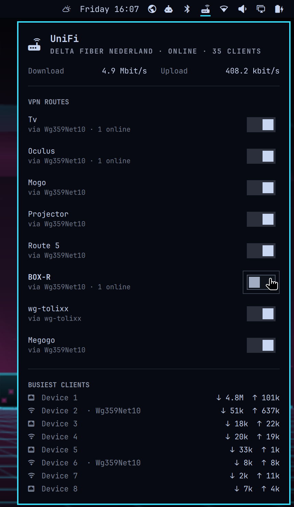

# UniFi for Omarchy

Switch your UniFi VPN routes from the Omarchy bar.

UniFi sends a device through a VPN client with a policy route ("Traffic Route" in Settings > Routing). This widget lists those routes with an on/off switch each, and adds new ones: pick a device, pick a VPN, and its internet traffic goes through that tunnel. It also shows WAN rates and the busiest clients.



For full network monitoring (devices, WAN links, client search) look at the other UniFi plugins on [plugins.omarchy.org](https://plugins.omarchy.org). This one is about the route switches.

## Features

- Gateway glyph in the bar, tooltip with download and upload
- Right click shows the live download rate in the bar
- Panel: ISP and WAN state, client count, download and upload
- One switch per policy route, with the VPN it uses and how many of its devices are online
- Add device: pick any online device without a route, then one of your VPN clients, and the gateway creates the route
- Remove a per-device route with the × next to it (click twice)
- Tunnel state from the gateway: routes and the VPN picker mark tunnels that are down, or that send without getting anything back
- Top 8 clients by traffic, wired or Wi-Fi, and which ones go through a VPN
- Keys: `j` / `k` move, `enter` flips the selected route, `x` removes it, `a` adds a device, `esc` goes back or closes

## Requirements

- A UniFi gateway on UniFi OS with an API key. Tested on a UniFi Express 7 with Network 10.6
- `python3` (standard library only)

## Install

```
omarchy plugin add https://github.com/tolixx/omarchy-unifi.git --enable
```

Then give it a key:

1. UniFi: Settings > Control Plane > Integrations > Create API Key
2. Save the key:
   ```
   mkdir -p ~/.config/omarchy-unifi
   nano ~/.config/omarchy-unifi/key        # paste the key, one line
   chmod 600 ~/.config/omarchy-unifi/key
   ```
3. Point it at your gateway in `~/.config/omarchy-unifi/config.json`:
   ```json
   {"host": "https://192.168.1.1", "site": "default"}
   ```

The gateway uses a self-signed certificate on the LAN, so the helper does not verify TLS. Use the LAN address, not a remote one.

The key has the rights of the UniFi user that created it. Switching, adding and removing routes writes to the gateway, the same as doing it in the UniFi app.

### Remove

```
omarchy plugin remove tolixx.unifi
rm -r ~/.config/omarchy-unifi
```

The plugin writes nothing else to your system. Routes stay as you last switched them.

### Optional settings

```json
{
  "host": "https://192.168.1.1",
  "site": "default",
  "aliases": {"aa:bb:cc:dd:ee:ff": "Desk PC"},
  "hide_names": true
}
```

- `aliases`: your own names for clients, by MAC
- `hide_names`: clients without an alias show as "Device 1", "Device 2"... Handy before a screenshot

In the bar widget settings: refresh interval (default 10 s) and whether to show the download rate.

## CLI

The panel runs `bin/omarchy-unifi`, which also works on its own:

```
omarchy-unifi bar                    # {"text": "↓ 6.2 Mbit/s ↑ 6.5 Mbit/s", "tooltip": ..., "class": "ok"}
omarchy-unifi panel                  # everything the panel shows, in one call
omarchy-unifi clients                # active clients, rates, and the route each one is on
omarchy-unifi routes                 # policy routes with their VPN
omarchy-unifi vpn <route-id> on|off  # switch a route
omarchy-unifi vpns                   # VPN clients a route can use
omarchy-unifi route-add <mac> <vpn-id> [name]  # send one device through a VPN
omarchy-unifi route-del <route-id>   # delete a route
```

A new route matches all of the device's internet traffic (UniFi's "Internet" target) with no kill switch. If the tunnel behind it is down, that device loses internet until you switch the route off or remove it.

## License

MIT
